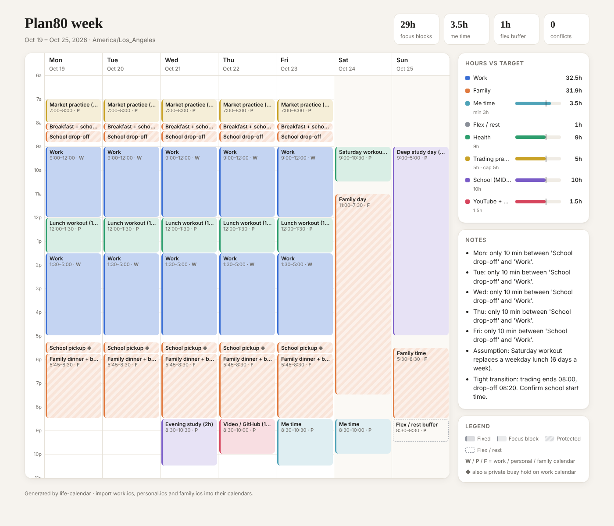

# Plan80

**Plan only 80% of your week. Protect health first, then fit everything else around it.**

Plan80 is a plugin with four skills that plans a realistic week for someone with a full-time
job, a degree, a health goal, family, daily practice and a growth project. It sorts every
commitment by priority, drops the lowest-priority blocks first when the week overflows, and
turns a sick week into a plan.



## The skills

| Skill | Use it when |
| --- | --- |
| `plan80-week` | Planning next week, or setting up your week for the first time |
| `plan80-sick-day` | Someone at home is sick and the week needs replanning |
| `plan80-why` | You want to know why a block was dropped, or what the rule is |
| `plan80-weekly-review` | Sunday check-in: planned vs. done, and small adjustments |

Each skill runs its own commands and opens the result in your browser. You never type a
command to see your week.

## Install

### Option A: Cowork (no terminal)

1. Download `plan80.plugin` from the file card in Cowork.
2. Open it and accept the plugin with the button.
3. Ask: "Plan my next week with Plan80."

If your organization controls which plugins are allowed, an admin may need to approve it first.

### Option B: Claude Code (terminal, but one-time)

```
/plugin marketplace add sherrywangzy/plan80
/plugin install plan80@plan80
```

Then ask: "Plan my next week with Plan80."

## Your data stays yours

On first run, the skill creates `~/Plan80/` on your computer and copies the example week
into `~/Plan80/life.json`. Your schedule, health details and trading routine live there,
never inside the plugin, so updating the plugin won't erase them. The repo's CI blocks any
personal config from being committed.

## How it decides

| Tier | Area | Dropped when over capacity? |
| --- | --- | --- |
| 0 | Work, family, sleep, me time, buffer | Never |
| 1 | Health | Never. A clash is a configuration error. |
| 2 | Daily practice | First among goals |
| 3 | School (hard deadline) | After tier 4 |
| 4 | Growth and launch | First |

Full rules: [planning rules](plugins/plan80/references/planning-rules.md). Design: [PRD](plugins/plan80/docs/PRD.md) and [architecture](plugins/plan80/docs/ARCHITECTURE.md).

## Tested

27 acceptance cases cover scheduling, constraints, priority, sick mode, privacy, retrieval
and plugin packaging. Results are in [`evals/RESULTS.md`](evals/RESULTS.md). Retrieval was
tuned on five questions and checked on two held-out ones; one held-out question still misses,
and the results file says so.

## Limits

- Times are local, with no DST handling inside a week.
- Retrieval is keyword-based, so questions far from the rules' wording can miss.
- Plan80 plans time. It is not financial advice and gives no trading signals.

## Development

```bash
python3 evals/run_evals.py
```

## License

MIT
