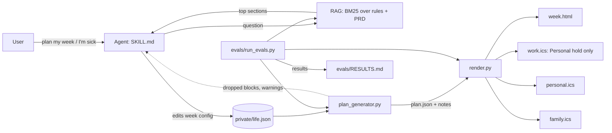

# Architecture: Plan80

Companion to [PRD.md](PRD.md). Written before the code, and updated when decisions change.

## 1. Overview

Plan80 splits the work between deterministic code and an AI agent.

- **Code decides the schedule.** Given the same config, it always produces the same plan.
  This is what makes the rules testable.
- **The agent handles the conversation.** It interviews the user, reads the config, asks
  what changed this week, explains dropped blocks, and answers questions. Its answers are
  grounded in retrieved sections of the user's own rules.

## 2. Components

| Component | Path | Responsibility | Depends on |
| --- | --- | --- | --- |
| Agent skill | `SKILL.md` | Workflow, tone, when to call each tool | All below |
| Config | `config/plan80.example.json`, `private/life.json` | Areas, tiers, colors, recurring blocks, sick days | Nothing |
| Generator | `scripts/plan_generator.py` | Expand blocks, resolve overlaps by tier, sick mode, hour checks | Config |
| Renderer | `scripts/render.py` | HTML week view, .ics per calendar, privacy rule | plan.json |
| Retrieval | `scripts/rag.py` | BM25 search over rules and PRD | Markdown docs |
| Evals | `evals/run_evals.py` | Acceptance tests for generator, renderer, retrieval | All above |
| CI | `.github/workflows/ci.yml` | Runs evals on every push | evals |

## 3. Data model

**Config** (`plan80.json`):

- `areas`: `{key: {label, color, tier, calendar, target_hours?, min_hours?, max_hours?}}`
- `blocks`: `[{area, title, days[], start, end, kind, inside_work?, hold_on_work?, sick_walk?}]`
- `sick_days`: `["tue", ...]`
- `sleep.lights_out`: `"22:30"`

**Plan** (`plan.json`, consumed by the renderer): `title`, `week_of`, `timezone`, `mode`,
`areas`, `events[]`, `notes[]`, `dropped[]`. The schema is unchanged from v0.1, so the
renderer doesn't need to change.

## 4. Key flows

**Normal week.** Expand blocks for each day, then sort by tier and start time, then keep
each block that doesn't clash with a kept block. A clash on a tier 2+ block drops it and
records the reason. A clash involving tier 0 or 1 raises `PlanError`.

**Sick day.** Tier 2–4 blocks on that day are dropped (reason: sick day). Health blocks
with `sick_walk` become a 20-minute walk. Then the first free 60-minute gap between 18:00
and 22:30 gets a rest block.

**Retrieval.** Split the corpus into sections on `## ` headings, tokenize, expand the
query with synonym groups, and score with BM25 (k1=1.5, b=0.75). The heading is weighted
three times the body.

## 5. Decisions (ADRs)

**ADR-001: Deterministic scheduler, not an LLM, for placement.**
*Context:* A plan is only useful if it's consistent and can be tested.
*Decision:* Code places blocks. The agent only proposes config changes, and the user confirms.
*Consequence:* Every rule is an eval. The tradeoff is less flexibility for unusual weeks,
which the config handles.

**ADR-002: JSON config, not YAML.**
*Context:* The target is zero dependencies. Python's standard library has no YAML parser.
*Decision:* JSON config.
*Consequence:* Slightly less readable than YAML. The example file is commented in the docs.

**ADR-003: Priority tiers, with tier 1 treated as a config error when it clashes.**
*Context:* "Everything is priority 1" was the original failure.
*Decision:* Tiers decide what's dropped. Tier 0/1 clashes raise an error, because they mean
the config is wrong, and silently dropping health would be worse.
*Consequence:* The user has to fix a conflicting config before the plan generates.

**ADR-004: BM25 retrieval, not embeddings, in v1.**
*Context:* The corpus is under 100 sections. Embeddings add an API dependency and cost.
*Decision:* BM25 with a small, evaluated synonym list.
*Consequence:* Retrieval quality is measured by evals. If it falls below target, embeddings
are the v2 option, and the eval suite will show it.

**ADR-005: Privacy by directory, enforced by CI.**
*Context:* Personal schedules and health data must never reach the public repo.
*Decision:* `private/` is gitignored and excluded from release zips. CI fails if a
personal config is committed.
*Consequence:* Users keep their own `private/life.json`. The example config holds only
placeholder titles.

## 6. Eval strategy

Evals test behavior, not implementation:

- **Golden cases:** a fixed config and week, with expected counts, durations and absences.
- **Invariants:** rules that must hold for any config, such as no tier 0 overlaps and
  nothing after lights-out.
- **Negative cases:** configs that must raise an error, such as a family block clashing
  with health.
- **Privacy case:** the work calendar output is checked as text, not just assumed safe.
- **Retrieval set:** questions paired with the section that should answer them.

Results are written to `evals/RESULTS.md` on each run, so regressions show up in the diff.

## 7. Security and privacy

- No network calls in the scripts. No API keys in the repo.
- `private/`, `plan.json` and `out/` are gitignored. The release zip excludes them.
- The work calendar receives only generic "Personal hold" events.
- Dependencies: none at runtime. Dependabot watches the GitHub Actions versions.
- Threats considered: accidental commit of personal data (CI check), leaked health details
  in screenshots (demos use placeholder data), and misuse of the planner as financial
  advice (scope limited to time).

## 8. Known limits (v1)

- Times are local, with no DST handling inside a week. Weeks crossing a DST change need a
  manual check.
- The agent can be wrong about what the user meant. The config is the source of truth, and
  the user confirms every change.
- Retrieval is keyword-based, so questions far from the rules' wording may miss.

## 9. Roadmap

- **v1.0:** generator, renderer, sick mode, privacy, retrieval, evals, CI.
- **v1.1:** school checkpoint and weekly review prompts from logged results.
- **v2:** opt-in calendar connectors with per-change approval; embeddings only if retrieval
  evals miss target.
